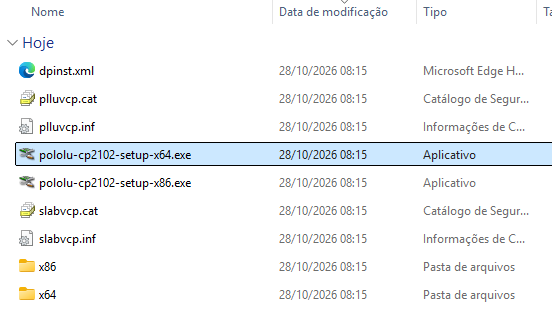
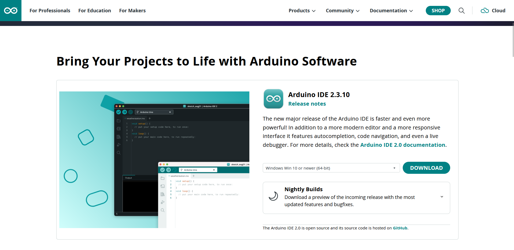
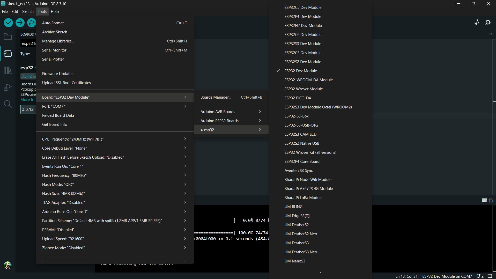
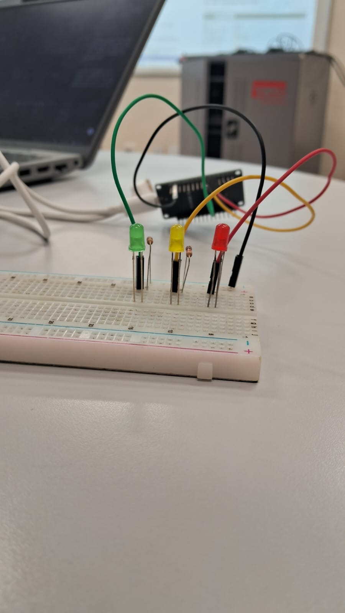
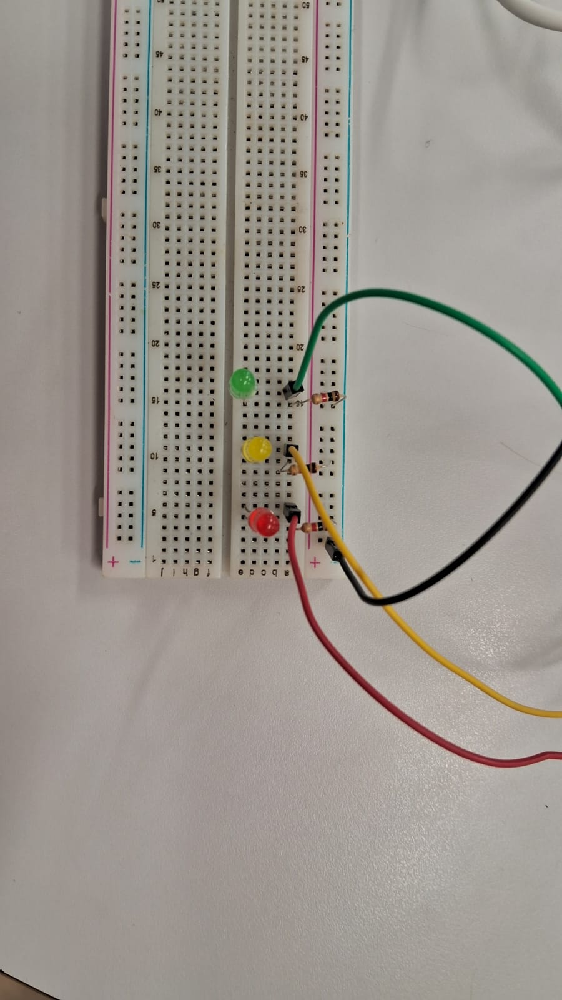
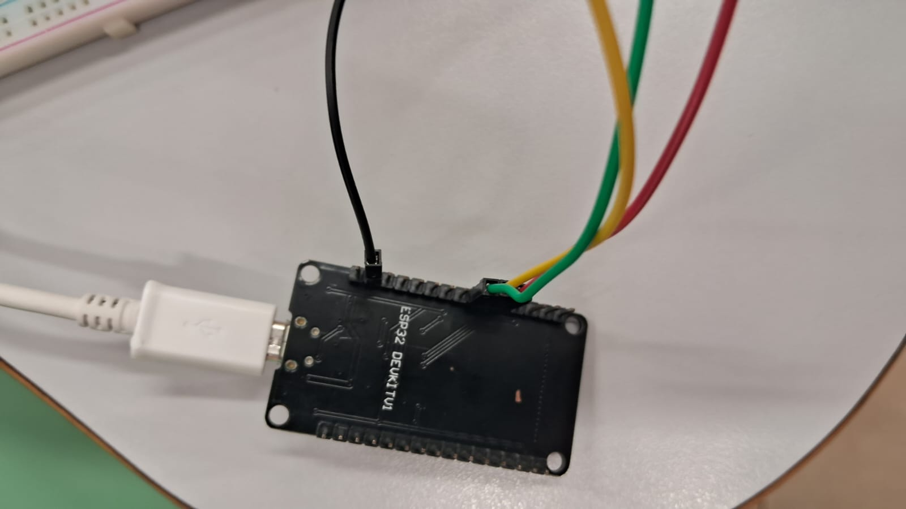
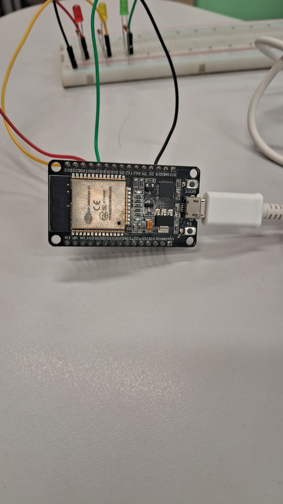
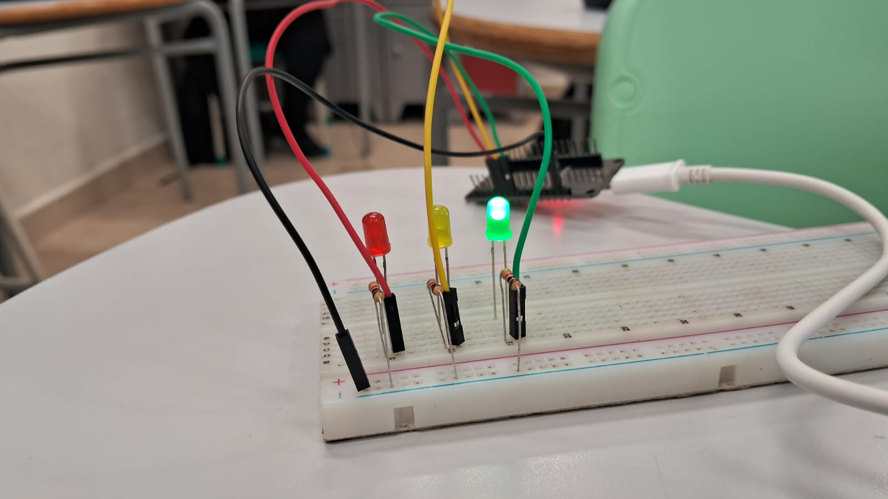

# ESP32 DevKit V1 no Arduino IDE: instalação e compilação

Este tutorial configura uma **ESP32 DevKit V1** no Windows 10/11 (64 bits), compila o exemplo de semáforo e grava o programa na placa. No Arduino IDE, selecione **ESP32 Dev Module**. A porta **COM7** da captura de tela é um exemplo; no seu computador, ela pode ter outro número.

## 1. Separe o material

- ESP32 DevKit V1 e cabo USB **com transmissão de dados**;
- computador com Windows 10 ou 11 (64 bits);
- para testar o semáforo: LEDs verde, amarelo e vermelho, três resistores de 220 a 330 Ω, protoboard e jumpers.

O driver USB cria a porta COM usada na gravação. O pacote **esp32 by Espressif Systems** fornece as ferramentas de compilação. Instale ambos conforme os próximos passos.

## 2. Instale o driver USB da placa

As instruções abaixo são para placas com conversor USB serial **CP2102/CP210x**. Se a placa já aparece como porta COM no Gerenciador de Dispositivos, o driver pode estar instalado.

1. Baixe o [driver CP2102 para Windows da Pololu](https://www.pololu.com/file/0J14/pololu-cp2102-windows-220616.zip), já indicado neste projeto.
2. Clique com o botão direito no arquivo `.zip` e escolha **Extrair tudo**. Abra a pasta extraída; não execute o instalador de dentro do ZIP.
3. Execute `pololu-cp2102-setup-x64.exe` e confirme a instalação quando o Windows solicitar.

   

4. Conecte a ESP32 por USB. Abra **Gerenciador de Dispositivos > Portas (COM e LPT)** e anote a porta exibida, por exemplo `COM7`. Ela pode aparecer como **Silicon Labs CP210x USB to UART Bridge** ou com outro nome de adaptador CP2102.

Se o pacote da Pololu não funcionar para o conversor da sua placa, use o [CP210x Universal Windows Driver da Silicon Labs](https://www.silabs.com/software-and-tools/usb-to-uart-bridge-vcp-drivers): baixe o pacote, extraia-o e, no Gerenciador de Dispositivos, atualize o driver apontando para a pasta extraída. Confira o chip USB da placa antes de instalar: algumas DevKit V1 usam outro conversor e exigem o driver correspondente. Consulte também as [instruções da Pololu](https://www.pololu.com/docs/0J7/2).

## 3. Instale o Arduino IDE e o suporte à ESP32

1. Baixe e instale o [Arduino IDE para Windows](https://www.arduino.cc/en/software/). Abra o programa.

   

2. Acesse **File > Preferences** (**Arquivo > Preferências**). No campo **Additional Boards Manager URLs** (**URLs adicionais para Gerenciadores de Placas**), adicione a URL estável da Espressif:

   ```text
   https://espressif.github.io/arduino-esp32/package_esp32_index.json
   ```

   Se já houver outra URL no campo, mantenha-a e adicione esta em uma nova linha. Confirme em **OK**.
3. Abra **Tools > Board > Boards Manager** (**Ferramentas > Placa > Gerenciador de Placas**), pesquise `esp32` e instale **esp32 by Espressif Systems**. Aguarde o fim da instalação. Se aparecer **Installed/Instalado**, o pacote já está pronto.
4. Reinicie o Arduino IDE se a placa não aparecer no menu após a instalação.

## 4. Selecione a placa e a porta

1. Acesse **Tools > Board > esp32 > ESP32 Dev Module** (**Ferramentas > Placa > esp32 > ESP32 Dev Module**).
2. Em **Tools > Port** (**Ferramentas > Porta**), selecione a porta COM identificada no passo 2. **COM7 é apenas o exemplo desta montagem**: escolha a porta que surge ao conectar a sua ESP32.



## 5. Monte o semáforo

Com a placa desconectada do USB, procure na fileira de terminais da ESP32 os pinos marcados **18**, **19** e **21** (também chamados **GPIO 18**, **GPIO 19** e **GPIO 21**). Cada um controla um LED. Procure também um terminal marcado **GND**: ele é o **negativo comum** do circuito. **GND não é o mesmo pino que GPIO 18, 19 ou 21**; a marcação correta é GPIO 18, por exemplo, e não “GND 18”.

Ligue o fio de cada GPIO ao ânodo (perna longa) do LED correspondente. Ligue o cátodo (perna curta) de cada LED ao GND por meio de **um resistor próprio** de 220 a 330 Ω. Você pode reunir as três ligações negativas no trilho da protoboard e conectar esse trilho a um único pino GND da ESP32.

| LED | Terminal de saída na ESP32 | Fio e ligação |
| --- | --- | --- |
| Verde | GPIO 18 (18) | Fio verde: 18 → ânodo do LED verde; cátodo → resistor → GND |
| Amarelo | GPIO 19 (19) | Fio amarelo: 19 → ânodo do LED amarelo; cátodo → resistor → GND |
| Vermelho | GPIO 21 (21) | Fio vermelho: 21 → ânodo do LED vermelho; cátodo → resistor → GND |

Esses são os **pinos físicos dos fios na placa**. A porta **COM7**, selecionada no Arduino IDE, é a conexão USB com o computador e não corresponde a nenhum desses pinos.

As fotos abaixo mostram a montagem por diferentes ângulos. Confira os **nomes dos GPIOs impressos na sua placa**, pois a cor e a posição dos fios podem variar.

| Vista lateral dos LEDs e resistores | Vista superior da protoboard |
| --- | --- |
|  |  |

| Conexões na parte traseira da ESP32 | Conexões na parte frontal da ESP32 |
| --- | --- |
|  |  |

Depois da montagem, conecte o cabo USB. Os resistores limitam a corrente; não ligue os LEDs sem um resistor em série.

## 6. Compile e grave o código

No Arduino IDE, crie um sketch em **File > New Sketch** (**Arquivo > Novo Sketch**), substitua o conteúdo pelo código abaixo e salve como `Semaforo_ESP32`.

```ino
const int verde = 18;
const int amarelo = 19;
const int vermelho = 21;

void setup() {
  pinMode(verde, OUTPUT);
  pinMode(amarelo, OUTPUT);
  pinMode(vermelho, OUTPUT);
}

void loop() {
  // Verde: 3 segundos
  digitalWrite(vermelho, LOW);
  digitalWrite(amarelo, LOW);
  digitalWrite(verde, HIGH);
  delay(3000);

  // Amarelo: 1 segundo
  digitalWrite(vermelho, LOW);
  digitalWrite(amarelo, HIGH);
  digitalWrite(verde, LOW);
  delay(1000);

  // Vermelho: 3 segundos
  digitalWrite(vermelho, HIGH);
  digitalWrite(amarelo, LOW);
  digitalWrite(verde, LOW);
  delay(3000);
}
```

Clique em **Verify/Verificar** (ícone ✓) para **compilar**. Essa etapa não precisa da placa conectada. Se não houver erros, clique em **Upload/Carregar** (ícone →) para compilar e **gravar** o programa na ESP32 pela porta COM. Ao terminar, os LEDs devem repetir a sequência **verde por 3 s → amarelo por 1 s → vermelho por 3 s**. O sketch usa apenas funções incluídas no pacote da placa; não requer biblioteca extra.



## Se algo não funcionar

- **A porta COM não aparece:** confira se o cabo transmite dados, tente outra porta USB e veja o Gerenciador de Dispositivos. Se houver um dispositivo CP210x sem driver, refaça o passo 2. Se o chip USB não for CP210x, instale o driver do fabricante desse chip.
- **`ESP32 Dev Module` não aparece:** confirme que instalou **esp32 by Espressif Systems** e que a URL do passo 3 está correta; depois reinicie o IDE.
- **O código compila, mas não grava / `Failed to connect to ESP32`:** confirme a placa e a COM, feche o Monitor Serial e tente de novo. Se ficar em `Connecting...`, mantenha **BOOT** pressionado durante o início da gravação e solte quando ela começar. Se ainda falhar, tente **Tools > Upload Speed > 115200** e use um cabo USB de dados ligado diretamente ao computador.
- **A gravação termina, mas os LEDs não acendem:** confira GPIO 18/19/21, GND, polaridade dos LEDs e um resistor em série para cada LED. Pressione **EN/RESET** uma vez para reiniciar o programa.

## Integrantes do grupo

- [zenvexy](https://github.com/zenvexy)
- [davi-lm7](https://github.com/davi-lm7)
- [HenriqueAlth09](https://github.com/HenriqueAlth09)

Referências: [instalação do Arduino ESP32 pela Espressif](https://docs.espressif.com/projects/arduino-esp32/en/latest/installing.html), [compilação e gravação no Arduino IDE](https://support.arduino.cc/hc/en-us/articles/4733418441116-Upload-a-sketch-in-Arduino-IDE) e [solução de problemas de gravação da Espressif](https://docs.espressif.com/projects/arduino-esp32/en/latest/troubleshooting.html).
